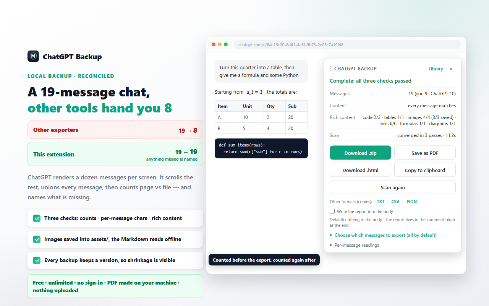

# ChatVault — back up the ChatGPT conversation you are reading

**ChatVault** is a free Chrome / Edge extension for [chatgpt.com](https://chatgpt.com). It scrolls the
conversation you have open, collects every message the page has loaded, and writes **one Markdown
file**. Then it counts what it wrote against what the page displayed — message counts, characters per
message, code blocks, tables, images, links, formulas and diagrams — and **names anything that does
not match**, instead of shipping a file that merely looks finished.



*Illustration, not a screenshot — the panel is shown with the English interface.*

**Chrome Web Store:** being submitted for review — the button goes here once the listing is live.
**Website:** https://socialgrabberapp.github.io/ChatVault/

> **About this repository:** it hosts the project's **website, privacy policy and screenshots** (the
> files served by GitHub Pages). It does **not** contain the extension's source code — the extension
> itself is distributed only through the browser stores. Open an
> [issue](https://github.com/socialgrabberapp/ChatVault/issues) for support, bug reports or questions
> about the site.

## At a glance

| | |
|---|---|
| Cost | Free, no account, no daily quota, no ads, no paid tier |
| Where the work happens | Entirely in your browser: scanning, comparing and writing |
| Uploads | None. No server, no analytics; generated images are read from the page you already have open |
| Permissions | `storage` only — no host permissions, no `tabs`, no network hosts |
| Where it runs | `chatgpt.com` and `chat.openai.com`, and nowhere else |
| Keyboard shortcut | `Alt+B` opens the panel (there is also a tab on the right edge of the page) |
| UI language | Simplified Chinese and English, follows the browser's UI language |
| Minimum Chrome | 111 |

## What one export gives you

```
Downloads/
├── <conversation title>.md          the conversation, with the figures it could keep
└── <conversation title>.zip         only when the chat has generated images
    ├── <conversation title>.md
    ├── <conversation title>.html    printable page, opens by double-click
    └── assets/gen-1.png             the images, fetched from the page itself
```

Three details that are deliberate:

- **The file is not declared complete.** When the page never rendered a message, or a reply was
  already empty, the report says which message it was. No placeholder is written that would read
  like content.
- **The comparison is a reading, not a guess.** Message count, per-message character count and rich
  content are counted on both sides — page and file — before the download buttons are handed over.
  A short reply, a lost table, or a formula that arrived without its LaTeX source is listed by
  message number.
- **A local library remembers versions.** Each backup is recorded as a version of that conversation:
  time, message counts and the message-id list, which is what lets the next export spot what
  disappeared since last time. The library holds metadata only, sits in your browser's local
  storage, and **never deletes a record by itself** — when space runs low it tells you and you
  decide.

## Five ways out

Download `.md`; download a `.zip` with images, a printable `.html` and the Markdown; save as PDF
through your browser's own print dialog; copy the body to the clipboard; or take a plain-text / CSV /
JSON copy of the report. A partial export — tick only some messages — is deliberately **not**
recorded in the library, so it can never become the baseline for the next comparison.

## What it deliberately does not do

It does not page through your history, run on a schedule, sync to a cloud, or call an internal API.
It reads the conversation in front of you. It cannot invent a message the page never rendered, and
it cannot recover a code block's language tag when the page does not expose one — both of those are
shown in the report as a number, not hidden.

## Privacy

Read [privacy-policy.html](privacy-policy.html). Short version: the only permission is local
storage, there is no server and no analytics, nothing you view is transmitted, and the files land in
your own Downloads folder.

## Trademark note

ChatVault is not affiliated with OpenAI. ChatGPT and OpenAI are trademarks of OpenAI; all product
names belong to their respective owners. Back up only conversations you are entitled to keep — you
are responsible for complying with the service terms and your local laws.

## Contact

`socialgrabber.app@gmail.com` · [Issues](https://github.com/socialgrabberapp/ChatVault/issues)
